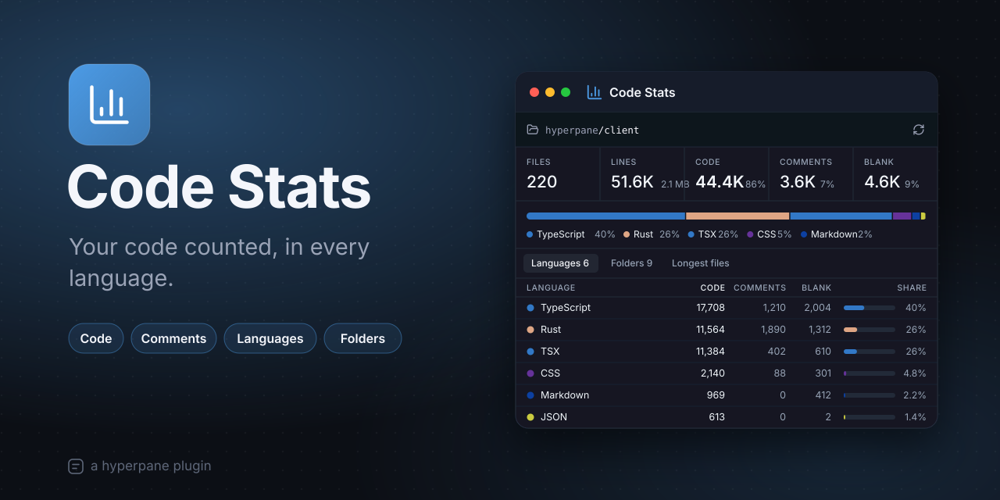

# Code Stats

Your code counted, in every language. Code Stats counts the lines in your
project's folder, or any folder you link to it: lines of code, comments and
blank lines, by language and by folder, with the longest files.

## Features

- **The totals:** files, lines, lines of code, comments and blank lines,
  each with its share.
- **Languages:** a bar of every language by its code, and a table of each
  one's files, code, comments, blanks, lines and size. About 100 languages,
  known by a file's name (`Dockerfile`, `Makefile`), its extension, or its
  `#!` line.
- **Folders:** the same for each folder at the top, with a bar of its
  languages.
- **Longest files:** the 100 longest. Double-click one to open it.
- **Sort by any column:** click its head, and again for the other way.
- **A folder in:** link a folder to the **Folder** port in nodes mode
  (Explorer's folder or its selection, Git's folder) and Code Stats counts
  that one. A file works too.
- **Stats out:** each count's totals and languages go out at the **Stats**
  port, as JSON.
- **What it left out, said:** binary files, files over 2 MB, generated ones
  (lock files, minified files, source maps), and text in a language it
  doesn't know, by extension.

## How to use

1. Open a project, then open Code Stats: **+** on the project, or
   right-click the canvas.
2. It counts the project's folder. Click the path at the top to count
   another folder, given as a full path or one from the project's folder.
3. Or, in nodes mode, link Explorer's **Folder** to Code Stats' **Folder**:
   it counts each folder you open there.
4. **Count again** (↻) after changes. The folder button puts it back on
   the project's folder.

## Good to know

- **Which files:** in a git repository, the files git has and the ones it
  doesn't ignore (`git ls-files --cached --others --exclude-standard`), so
  `.gitignore` is followed. Elsewhere, every file but in `node_modules`,
  `.git`, `dist`, `build`, `target`, `vendor`, `.venv` and the like, and
  hidden folders (except `.github`).
- **Code, comment or blank:** a line with code on it is code, even with a
  comment after. A line with only a comment, or inside a block comment, is
  a comment. A line of spaces is blank. Strings are stepped over, so `//`
  in `"http://…"` isn't a comment. Block comments nest where the language
  says so (Rust, Swift, Kotlin, Haskell…).
- **Docstrings** (Python's `"""…"""`) count as code, and so does text in
  Markdown and plain text files: their lines with something on them.
- It stops at 100,000 files and says so.

## How it works

The server part lists the files, then reads them, 16 at a time, where the
project is. It says how far it is as it goes, and the window shows the
stats when it's done. Nothing is kept: each count starts again.

## Develop

```sh
./build.sh --test
```

## License

MIT, © 2026 Astralyx. See [LICENSE](LICENSE).
